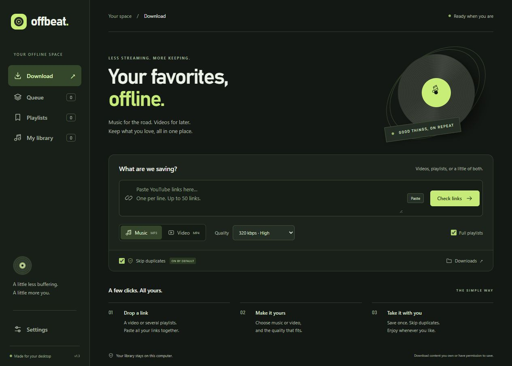

<p align="center"></p>

# Offbeat

**A simple YouTube music and video downloader for Windows.**

[](https://github.com/RAFIK-404/Offbeat-YouTube-Music-Video-Downloader/actions/workflows/tests.yml)

Download videos, music, and full playlists in a dark desktop app. Save several files at once, skip duplicates, and keep your favorite playlists ready for their next update.



**Public beta · Windows x64 · Python + pywebview · Powered by yt-dlp and FFmpeg**

## What it does

- **Music and video:** export MP3 at 128, 192, or 320 kbps, or MP4 up to the source's available quality.
- **Parallel downloads:** run up to six transfers at once; three is the default.
- **Multiple links:** paste up to 50 video or playlist links into one preview. Overlapping video IDs are merged.
- **Saved playlists:** use **Download new** to collect additions and replace missing files. Each playlist remembers its format, quality, and destination.
- **Duplicate skipping:** recognize saved or queued videos by YouTube ID and media type, even when their title changes.
- **A useful queue:** see total speed, progress, approximate time remaining, and free disk space. Pause new starts, cancel individual items, or retry failures.
- **Simple setup:** choose your download folder on first launch. Dark mode is the default.
- **Engine updates:** check for official yt-dlp updates inside Settings, with SHA-256 verification before installation.

## Get started

This first public beta is distributed as source. A public portable Windows download is pending completion of the bundled dependencies' redistribution package.

**[Download the source beta](https://github.com/RAFIK-404/Offbeat-YouTube-Music-Video-Downloader/releases/tag/v1.3.0-beta.1)** · [Report a problem](https://github.com/RAFIK-404/Offbeat-YouTube-Music-Video-Downloader/issues/new/choose)

Requirements: **64-bit Windows 10/11**, **Python 3.11 or newer**, internet access, and the [Microsoft Edge WebView2 Runtime](https://developer.microsoft.com/en-us/microsoft-edge/webview2/).

Download this repository with **Code → Download ZIP**, extract it, and open PowerShell in its folder:

```powershell
py -3 -m venv .venv
.venv\Scripts\python.exe -m pip install -r requirements.txt
.venv\Scripts\python.exe scripts\fetch_tools.py
.venv\Scripts\python.exe app.py
```

The setup script downloads yt-dlp, Deno, and FFmpeg from their official GitHub releases and verifies their published SHA-256 digests. These tools are downloaded to your computer; their binaries are not committed to this repository.

1. Choose where to save downloads.
2. Paste your links and click **Check links**.
3. Choose **Music** or **Video**, quality, and the items to save.
4. Click **Download**. To revisit a playlist, choose **Save playlist**, then use **Playlists → Download new** next time.

See the [user guide](docs/USAGE.md) for formats, duplicate rules, upgrades, and queue controls, or the [troubleshooting guide](docs/TROUBLESHOOTING.md) when something fails.

## What to expect from the beta

- Windows is the supported desktop platform. macOS and Linux desktop builds have not been validated.
- Availability depends on YouTube. Private, region-restricted, removed, sign-in-required, or bot-challenged items may not download. Offbeat does not import browser cookies or account credentials.
- Different uploads of the same song count as different videos. Duplicate detection does not use audio fingerprinting.
- Higher MP3 bitrate cannot restore quality missing from the source. More simultaneous downloads do not guarantee proportional speed increases.
- **Pause queue** lets active transfers finish. Closing the app interrupts active work; reopening holds unfinished work until you retry and resume.
- Time remaining is an estimate. **Calculating…** appears until sufficient transfer data is available.
- In-app updates cover **yt-dlp only**, not Offbeat, FFmpeg, or Deno.

Use Offbeat for content you own or have permission to save. Offbeat is an independent project and is not affiliated with YouTube or Google.

## Your data

Settings, saved playlists, and download history stay in `data/` beside the app. Media goes to the folder you choose. The interface talks to a local server bound to `127.0.0.1`, with a different access token on each launch.

Offbeat's own code has no analytics or telemetry. It contacts YouTube for metadata and media, YouTube's image service for thumbnails, and GitHub for requested dependency downloads or update checks. Keep the `data/` folder private: it contains your playlist links, history, and local paths.

## Development

The backend uses Python's standard library. The desktop shell uses pywebview, and the interface is plain HTML, CSS, and JavaScript.

```powershell
# Run deterministic backend/API tests without downloading media
py -3 -m unittest discover -s tests -v

# Check frontend syntax (Node.js required for this check only)
node --check web/app.js

# Build a portable app for local testing, after the setup steps above
.venv\Scripts\python.exe -m pip install -r requirements-build.txt
.venv\Scripts\python.exe scripts\build.py
```

Build output goes to `dist/Offbeat/`. Keep its complete directory together. Review [release preparation](docs/RELEASING.md) before distributing bundled binaries.

The current suite has **40 automated tests** covering queue behavior, persistence, duplicates, saved playlists, updates, first-run setup, and API access checks. See [CONTRIBUTING.md](CONTRIBUTING.md) for development and issue-reporting guidelines. GitHub Actions runs the suite and JavaScript syntax check on Windows after pushes and pull requests.

## License and credits

Offbeat's original application code and interface are licensed under the [MIT License](LICENSE). Dependencies and bundled notices keep their own licenses; see [THIRD-PARTY-NOTICES.md](THIRD-PARTY-NOTICES.md).

Built with [yt-dlp](https://github.com/yt-dlp/yt-dlp), [FFmpeg](https://ffmpeg.org/), [Deno](https://deno.com/), and [pywebview](https://pywebview.flowrl.com/). The feature scope was inspired by [YoutubePlaylistDownloader](https://github.com/shaked6540/YoutubePlaylistDownloader); its code and assets were not copied.
